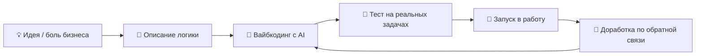

# 👋 Привет! Я Андрей Даниелян

### 🚀 Создаю digital-продукты на вайбкодинге — от сайта до CRM-системы

---

## 🧭 Обо мне

Я **предприниматель и генеральный директор** компании в сфере оптовых поставок строительных материалов. Я не классический программист — я **решаю задачи бизнеса с помощью ИИ**.

Мой подход — **вайбкодинг**: я формулирую идею, описываю логику и бизнес-процесс, а код пишется вместе с AI-ассистентами. Так я превращаю реальные рабочие задачи в работающие продукты — быстро, без многомесячной разработки и огромных бюджетов.

> 💡 *«Лучший код — тот, который решает реальную проблему. Неважно, кто нажимал клавиши — важно, что бизнес стал работать лучше.»*

---

## 🛠️ Что я создаю

<table>
<tr>
<td width="50%" valign="top">

### 🌐 Сайты и лендинги
- Корпоративные сайты компаний
- Продающие лендинги под продукт или услугу
- Каталоги товаров
- Адаптивная вёрстка под мобильные устройства
- Размещение на хостинге и подключение домена

</td>
<td width="50%" valign="top">

### 📊 CRM-системы
- Учёт клиентов, сделок и заявок
- Воронки продаж и статусы
- Распределение задач между менеджерами
- Дашборды и отчётность
- Системы под конкретный бизнес-процесс, а не «коробка»

</td>
</tr>
<tr>
<td width="50%" valign="top">

### 🤖 AI-агенты и автоматизация
- Агенты для обработки входящих заявок
- Автоматическое распределение задач
- Парсинг и разбор документов
- Интеграция ИИ в рабочие процессы
- Снижение ручной рутины

</td>
<td width="50%" valign="top">

### 📑 Работа с данными
- Автоматизация Excel-таблиц
- Анализ спецификаций и документов
- Сводные отчёты и аналитика
- Преобразование данных между форматами
- Инструменты для снабжения и закупок

</td>
</tr>
</table>

---

## ⚡ Как я работаю

1. **Начинаю с проблемы, а не с технологии.** Каждый проект рождается из реальной задачи — своей или клиента.
2. **Прототип за дни, а не за месяцы.** ИИ позволяет быстро проверить идею на практике.
3. **Проверка в бою.** Инструмент сначала работает в моей компании, и только потом становится продуктом.
4. **Итерации.** Постоянно улучшаю решения по обратной связи пользователей.

---

## 🏗️ Избранные проекты

| Проект | Описание | Статус |
|:--|:--|:--:|
| 🌐 **Корпоративный сайт** | Сайт компании-поставщика стройматериалов: каталог, контакты, заявки | 🟡 Запуск |
| 🤖 **Агент для снабжения** | Принимает заявки с объектов, собирает их в Excel и распределяет по менеджерам | 🟢 В разработке |
| 📊 **CRM для оптовых продаж** | Учёт клиентов, заявок и сделок под процессы B2B-поставок | 🔵 В планах |
| 📑 **Анализ спецификаций** | Разбор проектных спецификаций и подготовка данных для закупки | 🟢 Используется |

> 📌 *Некоторые проекты — внутренние инструменты компании, поэтому код может быть закрыт. Готов рассказать подробнее лично.*

---

## 🧰 Инструменты и технологии

**AI-ассистенты**

**Веб и разработка**

**Данные и документы**

**Инфраструктура**

---

## 🎯 Чем могу быть полезен

- ✅ Помочь **малому и среднему бизнесу** автоматизировать рутину
- ✅ Быстро собрать **MVP** для проверки бизнес-идеи
- ✅ Разработать **CRM под ваши процессы**, а не подстраивать процессы под CRM
- ✅ Внедрить **AI-агентов** в отдел продаж, снабжения или документооборот
- ✅ Поделиться опытом: **как предпринимателю без IT-бэкграунда создавать продукты**

---

## 📈 Статистика GitHub

---

## 📬 Связаться со мной

**Есть идея или задача? Пишите — обсудим, как превратить её в работающий продукт! 🚀**

